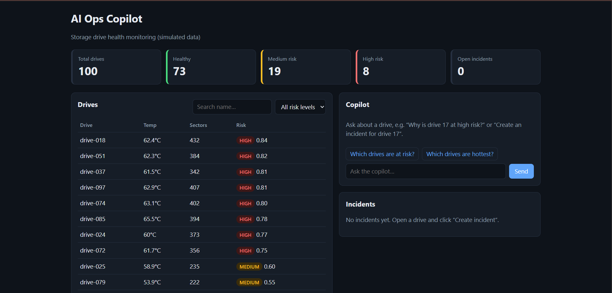

# AI Ops Copilot



Live demo: https://ai-ops-copilot-gzdc.onrender.com/

Storage-drive health monitoring with a built-in AI copilot. All data is **simulated**.

- **Backend:** FastAPI, SQLAlchemy 2, PostgreSQL (SQLite for quick local runs)
- **Risk engine:** transparent weighted rules (temperature, reallocated sectors, power-on hours, seek errors). It is a rule engine, not ML.
- **Copilot:** small agent that calls tools (drive status, history, at-risk, hot drives, create incident) and retrieves guidance from `knowledge/*.md` with a TF-IDF RAG index. Works with no API key. Set `ANTHROPIC_API_KEY` and it uses Claude to phrase the answer.
- **Frontend:** React (Vite), dashboard, drive detail charts, incident workflow, chat
- **Ops:** pytest, GitHub Actions CI, Docker, Render blueprint

## Run with Docker (everything: Postgres + API + UI)
```
docker compose up --build
```
Open http://localhost:8000 (API docs at /docs).

## Run for development
```
# terminal 1 - API (uses SQLite, auto-seeds 100 drives on first start)
cd backend
python -m venv .venv && source .venv/bin/activate      # Windows: .venv\Scripts\activate
pip install -r requirements.txt
uvicorn app.main:app --reload

# terminal 2 - UI
cd frontend
npm install
npm run dev                                            # http://localhost:5173
```

## Tests
```
cd backend && pytest -q
```

## API
| Method | Path | |
|---|---|---|
| GET | /health | liveness |
| GET | /api/v1/stats | counts by risk level, incidents |
| GET | /api/v1/drives?risk_level=&search=&limit=&offset= | paginated list |
| GET | /api/v1/drives/at-risk?min_level=MEDIUM\|HIGH | risky drives |
| GET | /api/v1/drives/{id} · /drives/{id}/history | one drive, telemetry |
| GET/POST | /api/v1/incidents | list / create |
| PATCH | /api/v1/incidents/{id} | OPEN, IN_PROGRESS, RESOLVED |
| POST | /api/v1/chat | copilot |

## Risk scoring
`score = 0.30*temp + 0.35*sectors + 0.15*power_on_hours + 0.20*seek_errors`, each normalized to 0..1 against fixed ranges (see `backend/app/services/risk_engine.py`). LOW < 0.40, MEDIUM < 0.70, HIGH ≥ 0.70. These thresholds are design choices, not validated against real failures.

## Deploy (Render, free tier)
Push to GitHub, then Render > New > Blueprint > select the repo. `render.yaml` creates the web service and a Postgres database. The first start seeds the data. Free instances sleep when idle, so the first request after a pause is slow.

## Honest limits
Simulated data only. No auth or rate limiting yet, so do not expose a public instance with real data. The copilot's LLM path is optional and its deterministic path is what the tests cover.
